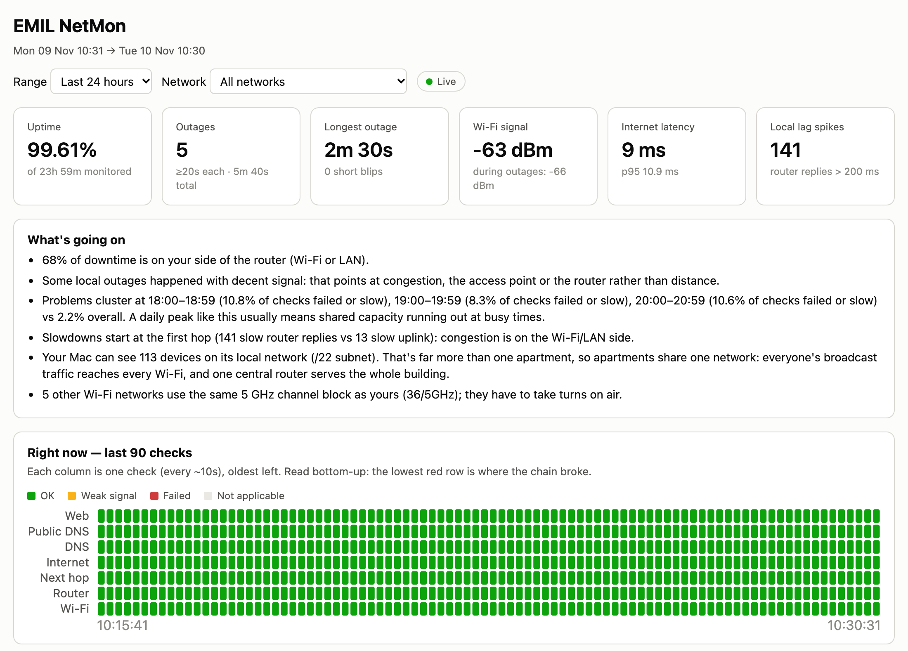
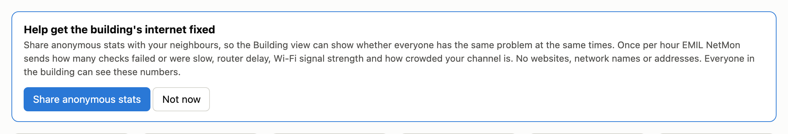
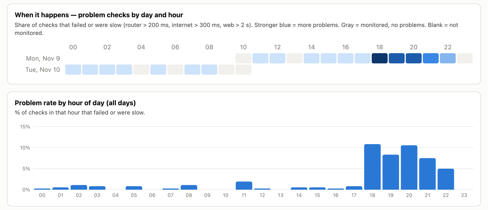
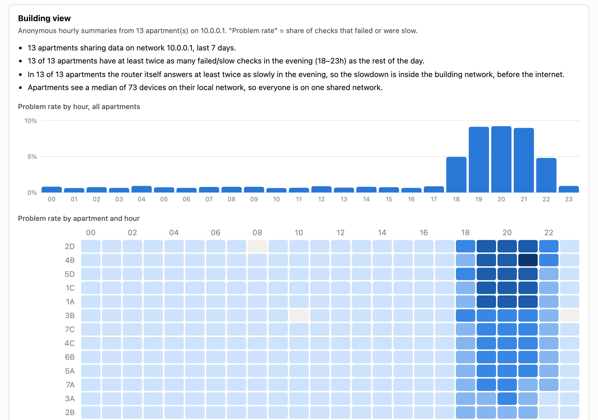

# EMIL NetMon

**Does the internet in our building keep dropping out, especially in the evenings?**

EMIL NetMon is a free Mac app that quietly checks your connection every 10 seconds and shows you
*where* it breaks: your Wi-Fi, the router, the building network, or the internet provider.
Together with your neighbours, it collects the evidence building IT needs to fix it.

### ⬇️ [Download EMIL NetMon for Mac](https://github.com/chris-boson/emil-netmon/releases/latest/download/EMIL-NetMon.zip)

Free · macOS 12 or newer · no account needed

## Get started in 2 minutes

1. **Download** the app above, unzip it, and move **EMIL NetMon** to your Applications folder.
2. **Open it.** The first time, macOS says it "cannot verify" the app, because it isn't from the
   App Store. Click **Done**, then open **System Settings → Privacy & Security**, scroll down and
   click **Open Anyway**.
   If you're asked to install "Command Line Tools", click **Install**, wait until it's done, and open the app again.
3. Your dashboard opens in the browser. Click **Share anonymous stats**. That's it.

EMIL NetMon keeps running in the background, also after restarts. Open the app again any time to get back to your dashboard.

## What you'll see

**When it happens.** Problems by day and hour, so you can see the evening pattern for yourself.

**The whole building.** Every apartment that shares appears side by side. If everyone has the
same problem at the same time, it's the building network, not your laptop. One click downloads
the data to send to building IT.

Screenshots show example data.

## Your privacy

Nothing leaves your Mac until you click **Share anonymous stats**. After that, once per hour,
it sends only numbers: how many checks failed or were slow, router delay, Wi-Fi signal strength,
how crowded your Wi-Fi channel is, and an apartment label if you choose to add one.

It never sends websites you visit, network names, addresses, names or email addresses.
Everyone in the building can see the shared numbers. Click **Stop sharing** at any time.

## Stop or uninstall

Click **Stop monitoring and uninstall** at the bottom of the dashboard. Your logs stay in the
hidden folder `~/.netmon`; delete it to remove everything.

## Questions

- **Does it slow down my internet?** No. Each check is a few tiny test messages.
- **Windows, iPhone or Android?** Sorry, Mac only for now.
- **Why the "Open Anyway" step?** Apple charges developers to sign apps. EMIL NetMon is a free
  neighbourhood project, and all its code is public in this repository.

---

Curious how it works, or want to run it from source? See [docs/technical.md](docs/technical.md).
